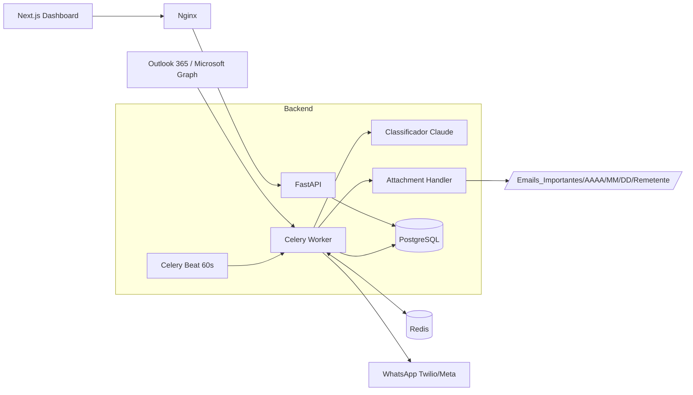
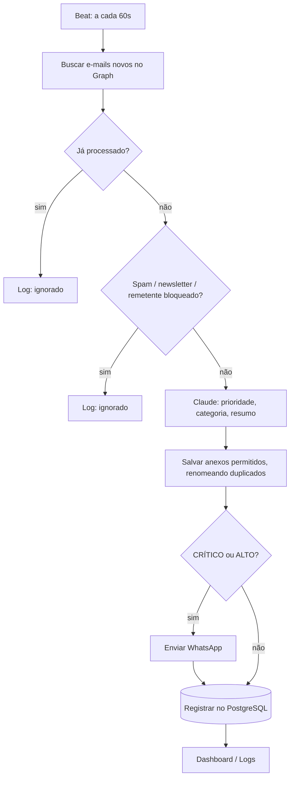

# Arquitetura Corporativa e Fluxo Operacional

## Componentes

## Fluxo operacional

## Segurança
- Credenciais criptografadas (Fernet); segredos só via `.env`.
- API protegida por `X-API-Key` (`API_ACCESS_TOKEN`); **obrigatório em produção**.
- Anexos: lista de extensões permitidas, executáveis bloqueados, nomes sanitizados.
- Logs auditáveis em banco; retenção configurável (LGPD).

## Limitações conhecidas
Ainda sem integração real testada contra Graph/WhatsApp (requer credenciais), e sem testes de integração.
