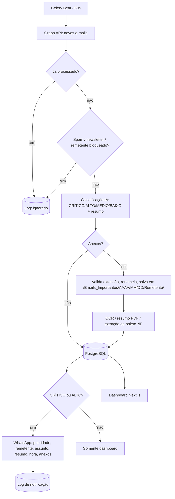

# Arquitetura Corporativa e Fluxograma Operacional

## Componentes
| Camada | Tecnologia | Função |
|---|---|---|
| Borda | Nginx | Reverse proxy, TLS (produção), rate limit |
| API | FastAPI | REST, dashboard, controle por `X-API-Key` |
| Fila | Redis + Celery (worker/beat) | Polling a cada 60s, processamento assíncrono |
| IA | Claude API (fallback por palavras-chave) | Prioridade, resumo, PDF, boletos/NF |
| Dados | PostgreSQL | E-mails, anexos, notificações, logs auditáveis |
| Integrações | Microsoft Graph (Outlook 365), WhatsApp (Twilio/Meta) | Entrada e saída |
| Frontend | Next.js + Tailwind | Dashboard |

## Fluxograma operacional

## Segurança
- Credenciais criptografadas (Fernet); segredos só via variáveis de ambiente.
- API protegida por `API_ACCESS_KEY` (header `X-API-Key`, comparação em tempo constante). Defina-a em produção e exponha o dashboard apenas atrás de VPN/SSO.
- Anexos: lista de extensões permitidas, executáveis bloqueados, nomes sanitizados (sem path traversal).
- LGPD: retenção de logs configurável, corpo de e-mail truncado nos logs.

## Limitações conhecidas
- Aprendizado contínuo, resposta automática e agrupamento por assunto estão planejados, não implementados.
- Integrações reais (Azure, WhatsApp, Claude) não foram testadas ponta a ponta neste ambiente.
