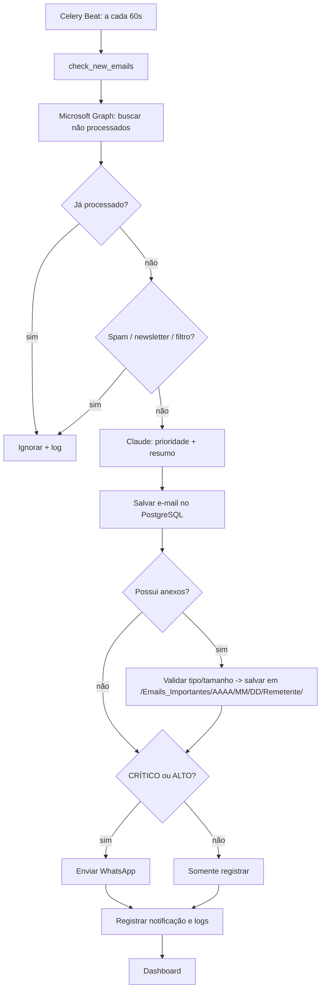

# Arquitetura e Fluxo Operacional

## Componentes
- **Nginx**: proxy reverso (frontend `/`, API `/api`).
- **Frontend (Next.js + Tailwind)**: dashboard, atualização a cada 30s.
- **Backend (FastAPI)**: API REST, health, configurações.
- **Celery Beat/Workers + Redis**: verificação a cada 60s e processamento assíncrono.
- **PostgreSQL**: e-mails, anexos, notificações, logs de auditoria.
- **Integrações**: Microsoft Graph (Outlook 365), Claude API (classificação/resumo), WhatsApp (Twilio/Meta).

## Fluxograma operacional

## Segurança
Credenciais criptografadas (Fernet), bloqueio de extensões executáveis, nomes de arquivo sanitizados e
deduplicados, logs auditáveis e retenção configurável (LGPD).

## Escalabilidade
Workers Celery horizontais (`--scale celery-worker=N`), fila Redis, pool de conexões PostgreSQL.
