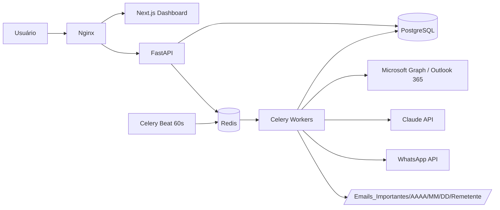
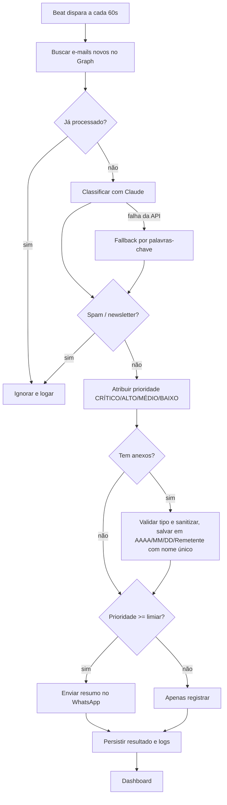

# Arquitetura e Fluxo Operacional

## Componentes

## Fluxo operacional

## Segurança
Credenciais criptografadas (Fernet), validação de extensão/tamanho de anexos, nomes sanitizados contra path traversal, logs estruturados e auditáveis, retenção conforme LGPD.
