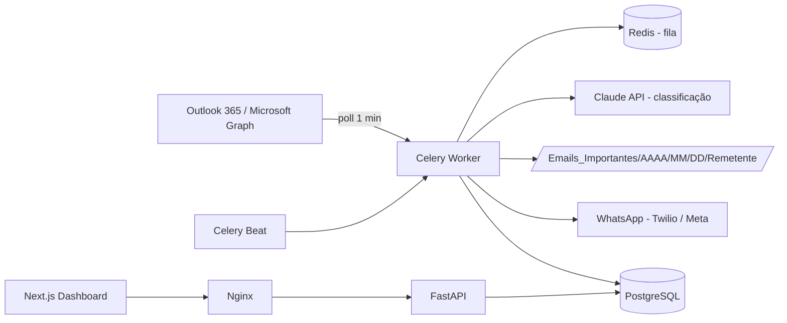
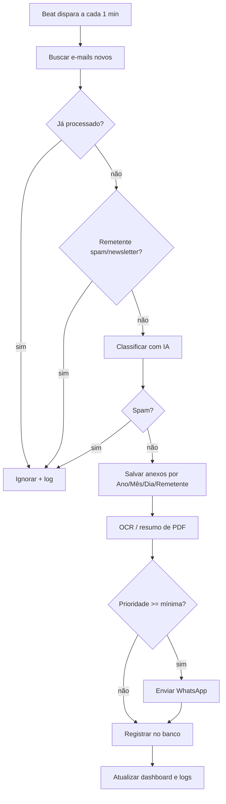

# Arquitetura e Fluxo Operacional

## Componentes

| Camada | Tecnologia | Responsabilidade |
|---|---|---|
| Ingestão | Microsoft Graph (MSAL) | Leitura de e-mails e anexos |
| Fila | Redis + Celery (+ Beat, Flower) | Processamento assíncrono, retries |
| IA | Claude API (fallback por palavras-chave) | Prioridade, resumo, spam |
| Notificação | WhatsApp (Twilio / Meta) | Resumo estruturado |
| Persistência | PostgreSQL | E-mails, anexos, notificações, logs |
| API/UI | FastAPI + Next.js/Tailwind | Dashboard e REST |

## Fluxo operacional

## Segurança
Credenciais cifradas (Fernet), validação de extensões/tamanho de anexos, nomes de arquivo sanitizados e únicos, logs estruturados auditáveis, mascaramento de dados sensíveis (LGPD).
