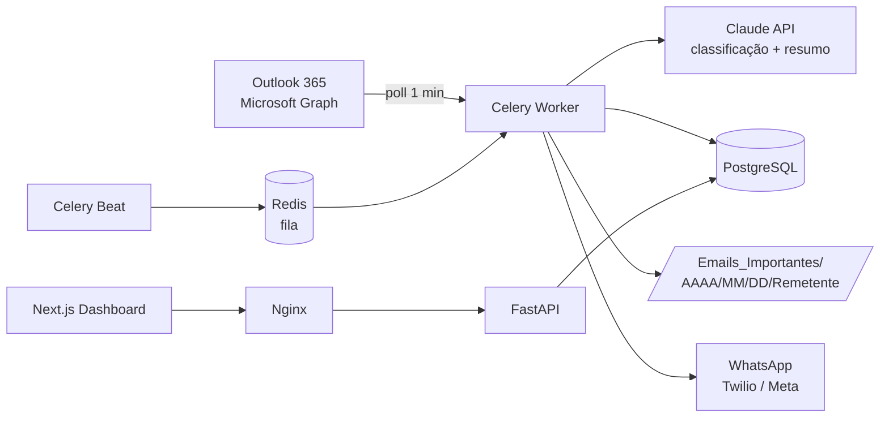

# Arquitetura Corporativa

## Visão geral

## Componentes

| Camada | Tecnologia | Responsabilidade |
|---|---|---|
| Ingestão | Microsoft Graph API | Leitura de e-mails, anexos e metadados |
| Orquestração | Celery + Redis | Agendamento (beat), filas, retentativas |
| IA | Claude API | Prioridade (CRÍTICO/ALTO/MÉDIO/BAIXO), resumo, detecção de spam |
| Persistência | PostgreSQL | E-mails, anexos, notificações, logs auditáveis |
| Notificação | WhatsApp (Twilio/Meta) | Envio do resumo estruturado |
| API | FastAPI | REST para dashboard e configurações |
| Frontend | Next.js + Tailwind | Painel de controle |
| Borda | Nginx | TLS, proxy reverso, rate limit |

## Segurança e LGPD

- Credenciais criptografadas (Fernet) e segredos só via variáveis de ambiente.
- Validação de extensão/MIME e sanitização de nomes de anexos; extensões executáveis bloqueadas.
- Logs auditáveis; retenção configurável com limpeza periódica.
- Dados pessoais minimizados no resumo enviado ao WhatsApp.
- Princípio do menor privilégio no registro Azure AD (`Mail.Read`).

## Escalabilidade

- Workers Celery horizontais (`docker compose up --scale worker=N`).
- Idempotência por `message_id` do Graph evita reprocessamento.
- Retentativa com backoff para falhas de WhatsApp (`retry_failed_notifications`).
