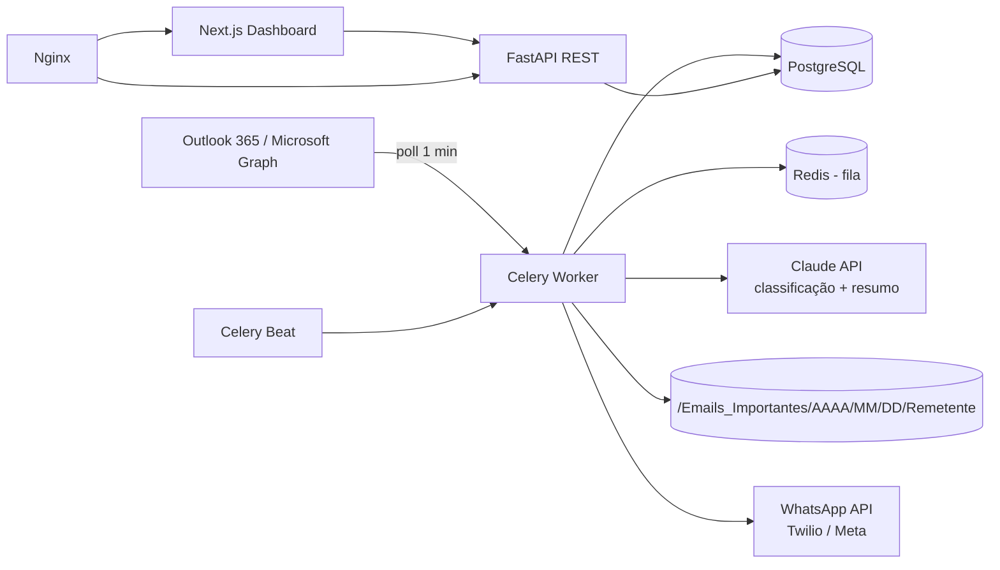
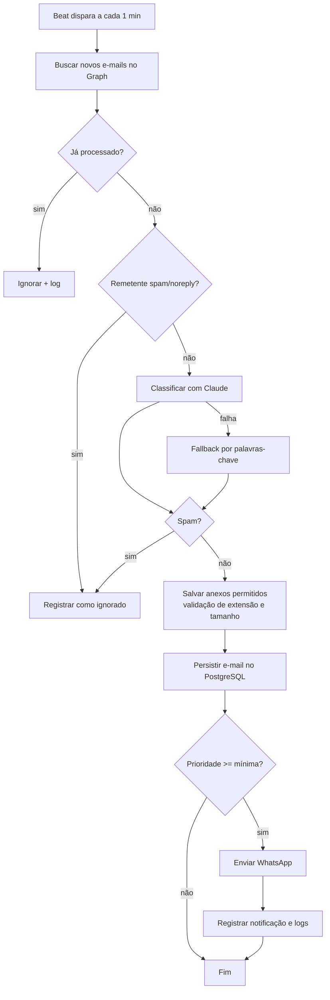

# Arquitetura Corporativa

## Visão geral

## Camadas

| Camada | Tecnologia | Responsabilidade |
|---|---|---|
| Ingestão | Microsoft Graph (OAuth2 client credentials) | Leitura de e-mails e anexos |
| Orquestração | Celery + Redis | Agendamento (1 min), filas, retentativas |
| Inteligência | Claude API (tool_use) + fallback por palavras-chave | Prioridade, resumo, spam |
| Armazenamento | PostgreSQL + volume de arquivos | Metadados, logs, anexos |
| Notificação | WhatsApp (Twilio / Meta) | Resumo estruturado |
| Apresentação | FastAPI + Next.js + Tailwind | API REST e dashboard |
| Borda | Nginx | Proxy reverso / TLS |

## Fluxograma operacional

## Segurança e LGPD

- Credenciais em variáveis de ambiente; tokens sensíveis cifrados (Fernet, `utils/crypto.py`).
- Anexos: lista de extensões permitidas, limite de tamanho, nomes sanitizados e sem sobrescrita.
- Logs estruturados e auditáveis; corpo completo do e-mail não é persistido (apenas prévia).
- Retenção configurável e acesso restrito ao volume de anexos.
