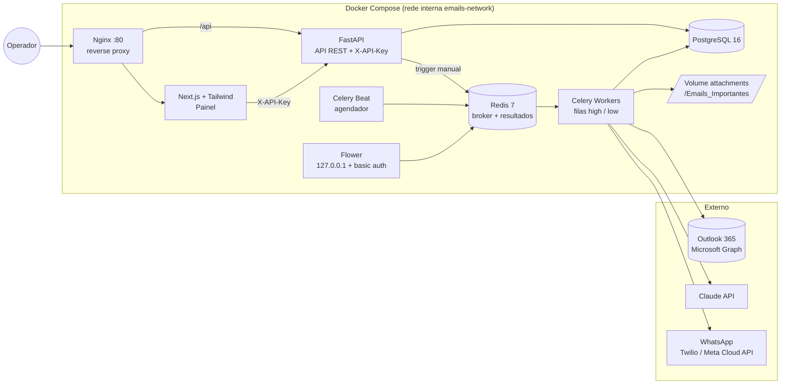

# Arquitetura Corporativa

## Componentes

| Camada | Tecnologia | Responsabilidade |
|---|---|---|
| Ingestão | Microsoft Graph (MSAL client credentials) | Ler não lidos, cabeçalhos, anexos; marcar como lido |
| Pré-filtro | `app/services/prefilter.py` | Regras sem custo: listas allow/block/VIP, `List-Unsubscribe`, `Precedence`, `Auto-Submitted`, sinais de contexto |
| IA | Claude (`tool_use` com schema) | Prioridade CRÍTICO/ALTO/MÉDIO/BAIXO, categoria, resumo, ação necessária, spam |
| Anexos | `app/services/attachment_handler.py` | Allowlist de extensões, verificação de magic bytes, inspeção de ZIP, OCR (Tesseract), texto de PDF, extração de boleto/NF |
| Notificação | `app/services/whatsapp_sender.py` | Twilio ou Meta, com reenvio automático de falhas |
| Persistência | PostgreSQL + SQLAlchemy async | `email_records`, `email_attachments`, `notification_logs`, `processing_logs` |
| Fila | Redis + Celery | Filas `high` (ciclo e reenvio) e `low` (resumo e limpeza), `acks_late`, `prefetch=1` |
| Painel | Next.js 14 + React Query | KPIs do dia, gráfico por prioridade, tabela de e-mails, histórico de notificações, status das integrações |

## Segurança e LGPD

- **Controle de acesso**: toda a API (exceto `/api/health`) exige `X-API-Key`, com comparação em tempo constante. Sem `API_KEY` em produção, a API recusa as requisições (fail-closed). O painel pede a chave ao operador e a guarda apenas em `sessionStorage`.
- **Superfície exposta**: só o Nginx (porta 80) fica público. Backend, frontend e Flower são publicados apenas em `127.0.0.1`, e o Flower exige basic auth.
- **Credenciais**: ficam em variáveis de ambiente, fora do Git. `app/utils/crypto.py` (Fernet) está disponível para cifrar segredos que precisem ser guardados em banco, e a API nunca devolve segredos.
- **Anexos maliciosos**: extensões perigosas e duplas (`.pdf.exe`), macros (`.docm`, `.xlsm`), executáveis disfarçados (assinatura `MZ`/ELF), ZIPs com executáveis ou criptografados são todos bloqueados e registrados em `processing_logs`.
- **Auditoria**: cada ação (processado, ignorado com motivo, anexo salvo, WhatsApp enviado/falho, erro, ciclo) vira uma linha em `processing_logs` com duração, além de log JSON estruturado (structlog).
- **LGPD**: a retenção de logs é configurável (`LOG_RETENTION_DAYS`). Para o corpo do e-mail, o Claude recebe apenas os primeiros 3.000 caracteres. Os dados ficam no seu próprio PostgreSQL e volume. Recomenda-se cifrar o disco do volume `attachments_data` e registrar a base legal (legítimo interesse/execução de contrato) no RoPA da empresa.

## Escalabilidade

- Workers horizontais: `docker compose up -d --scale celery-worker=4`.
- O Beat deve ter uma única instância.
- Para várias caixas de correio, parametrize `OUTLOOK_EMAIL_ADDRESS` por tarefa ou use Graph change notifications (webhooks) para chegar a tempo real abaixo de 60s.
