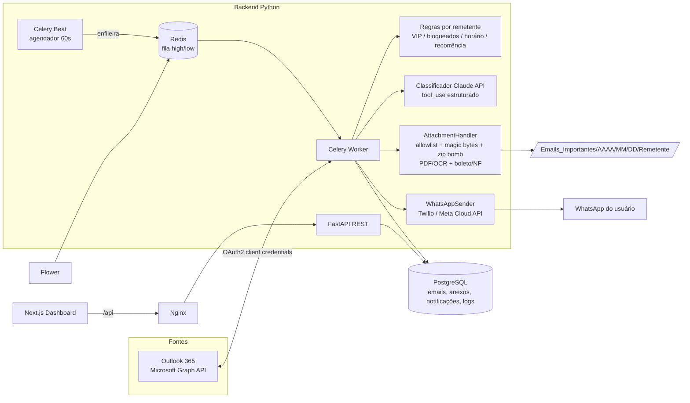
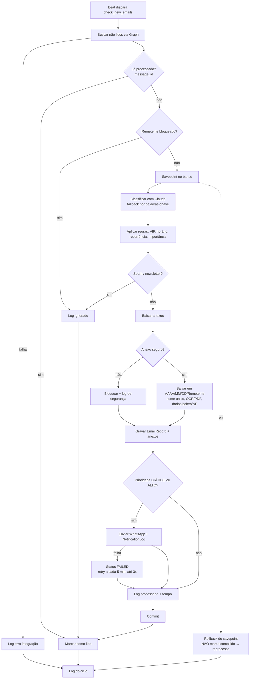

# Arquitetura Corporativa e Fluxograma Operacional

## Visão de componentes

## Fluxograma de processamento de um e-mail

## Garantias operacionais

| Aspecto | Como é garantido |
|---|---|
| Sem perda de e-mail | Marca como lido **somente após commit**; erro ⇒ reprocessado no próximo ciclo |
| Sem duplicidade no banco | `message_id` único + verificação antes de processar |
| Isolamento de falhas | Savepoint (`begin_nested`) por e-mail |
| Anexos maliciosos | Allowlist de extensões, bloqueio de dupla extensão (`.pdf.exe`), validação de magic bytes, inspeção de ZIP (executáveis internos e zip bomb) |
| Notificação resiliente | `retry_failed_notifications` a cada 5 min |
| Auditoria / LGPD | `processing_logs` com toda ação (processado, ignorado, anexo salvo/bloqueado, WhatsApp, erros, duração); retenção configurável `LOG_RETENTION_DAYS` |
| Credenciais | Variáveis de ambiente + `ENCRYPTION_KEY` (Fernet) para segredos persistidos |

## Rotinas automatizadas (Celery Beat)

| Rotina | Frequência | Fila |
|---|---|---|
| `check_new_emails` | `CHECK_INTERVAL_SECONDS` (padrão 60s) | high |
| `retry_failed_notifications` | 5 min | high |
| `send_daily_summary` (WhatsApp) | diário 08:00 | low |
| `cleanup_old_logs` | domingo 02:00 | low |
