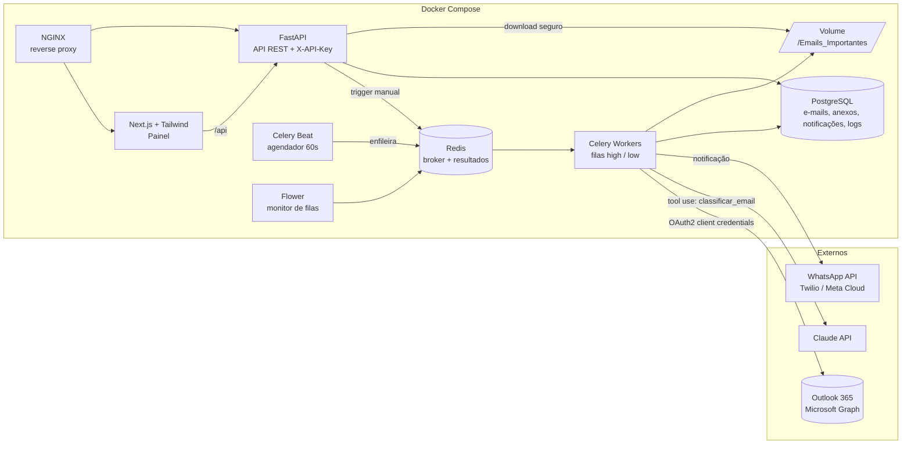
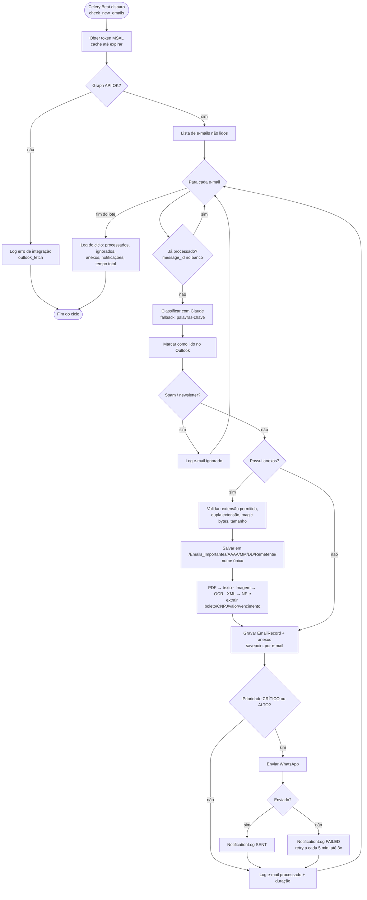

# Arquitetura Corporativa e Fluxograma Operacional

## 1. Visão de componentes

| Camada | Tecnologia | Responsabilidade |
|---|---|---|
| Ingestão | Microsoft Graph (MSAL) | Busca e-mails não lidos, anexos e marca como lido |
| Orquestração | Celery Beat + Redis | Ciclo a cada `CHECK_INTERVAL_SECONDS` (padrão 60s), retry de notificações (5 min), resumo diário (08:00), limpeza de logs (domingo 02:00) |
| Inteligência | Claude API (tool use) + fallback por palavras-chave | Prioridade, categoria, resumo, detecção de spam/newsletter, ação requerida |
| Notificação | Twilio ou Meta WhatsApp Cloud API | Mensagem no formato `[CRÍTICO] …` para CRÍTICO e ALTO |
| Armazenamento | PostgreSQL + volume de arquivos | Registro completo e auditável; anexos em `/Emails_Importantes/AAAA/MM/DD/Remetente/` |
| Apresentação | FastAPI + Next.js | API REST protegida e painel (dashboard, e-mails, notificações, anexos, logs, configurações) |

## 2. Fluxograma operacional (um ciclo)

Uma falha num e-mail desfaz apenas o *savepoint* daquele e-mail. Ela vira um log `email_processing` com o tipo do erro, e o restante do lote segue normalmente.

## 3. Segurança e LGPD

- **Controle de acesso:** todas as rotas `/api/*`, exceto `/api/health`, exigem o header `X-API-Key` (`API_ACCESS_KEY`), comparado em tempo constante.
- **Credenciais:** ficam em variáveis de ambiente/`.env` (fora do Git), com utilitário Fernet em `app/utils/crypto.py` para criptografar segredos em repouso.
- **Anexos maliciosos:** a lista de extensões permitidas fica fixa no código, com bloqueio de dupla extensão (`fatura.pdf.exe`), detecção de executáveis disfarçados por assinatura binária (MZ, ELF, Mach-O), proteção contra XXE nos XMLs e limite de tamanho.
- **Download:** o arquivo é resolvido dentro do diretório base, o que impede *path traversal*.
- **Auditoria:** a tabela `processing_logs` registra cada ação com sucesso/erro, tipo, mensagem e duração. A retenção é configurável (`LOG_RETENTION_DAYS`).
- **Minimização (LGPD):** a API de configurações não expõe credenciais, e a retenção de logs é limitada.

## 4. Escalabilidade

- Os workers escalam horizontalmente (`docker compose up -d --scale celery-worker=4`). A deduplicação por `message_id` (índice único) evita processamento duplo.
- Há filas separadas: `high` para ingestão e notificações e `low` para resumo e limpeza.
- `worker_prefetch_multiplier=1` e `task_acks_late=True` fazem uma tarefa interrompida voltar para a fila.
- O pool asyncpg é descartado ao fim de cada tarefa Celery, porque cada uma roda num event loop próprio.
