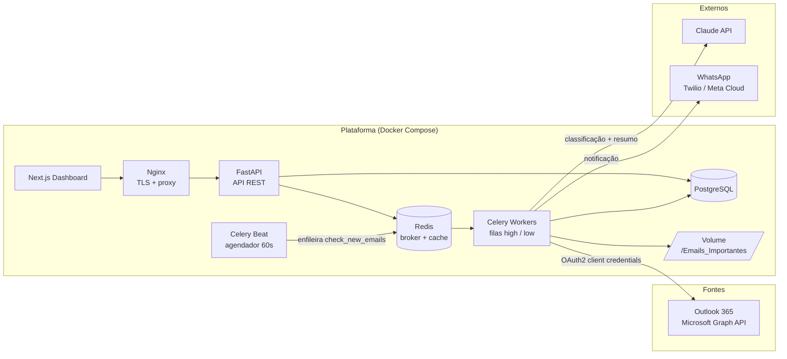
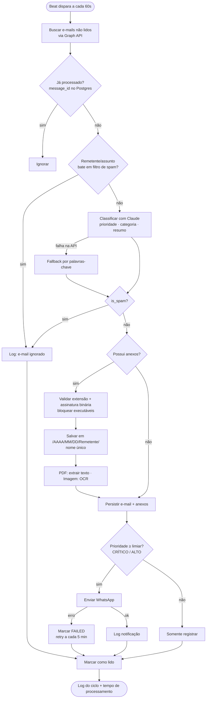

# Arquitetura Corporativa e Fluxograma Operacional

## Visão de componentes

## Fluxograma operacional (ciclo de 1 minuto)

## Rotinas agendadas

| Rotina | Frequência | Fila | Função |
|---|---|---|---|
| `check_new_emails` | `CHECK_INTERVAL_SECONDS` (60s) | high | Ciclo principal acima |
| `retry_failed_notifications` | 5 min | high | Reenvia WhatsApp com falha |
| `send_daily_summary` | 08:00 diário | low | Resumo do dia anterior no WhatsApp |
| `cleanup_old_logs` | Domingo 02:00 | low | Remove logs além de `LOG_RETENTION_DAYS` |

## Segurança e LGPD

- **Credenciais**: segredos só via variáveis de ambiente / `.env` (fora do git); valores sensíveis guardados no banco são cifrados com Fernet (`app/utils/crypto.py`).
- **Autenticação Graph**: app registration com permissão mínima `Mail.Read` + `Mail.ReadWrite` (para marcar como lido), restrita à caixa via *Application Access Policy*.
- **Anexos maliciosos**: allowlist de extensões, blocklist de executáveis, detecção de executável disfarçado por *magic bytes*, limite de tamanho.
- **Auditoria**: toda ação gera registro em `processing_logs` (tabela) + log estruturado JSON.
- **Minimização (LGPD)**: retenção configurável, corpo completo pode ser descartado; a Claude API recebe apenas os primeiros 3.000 caracteres do corpo.

## Escalabilidade

- Workers stateless — escale com `docker compose up --scale celery-worker=N`.
- Idempotência por `message_id` único evita duplicidade em execuções concorrentes.
- `task_acks_late` + `prefetch_multiplier=1` garantem reprocessamento se um worker cair.
