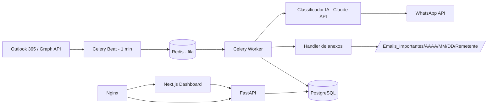
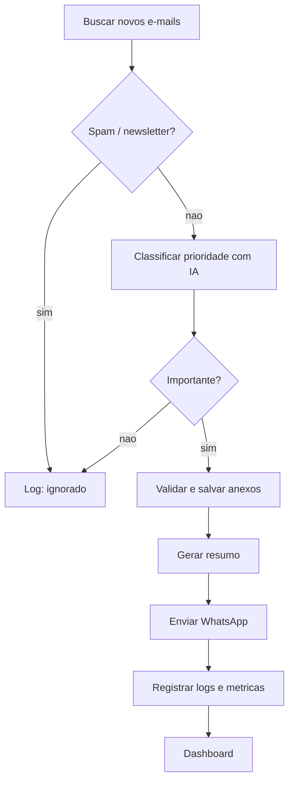

# Arquitetura e Fluxograma Operacional

## Arquitetura

## Fluxo operacional

## Seguranca
Credenciais criptografadas (`utils/crypto.py`), sanitizacao e validacao de anexos (`utils/sanitizer.py`, `utils/file_utils.py`), logs auditaveis, minimizacao de dados (LGPD).
