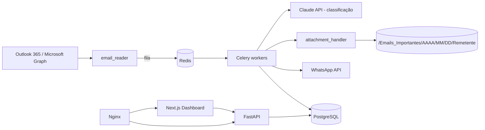

# Arquitetura Corporativa

## Visão geral

## Componentes

| Camada | Tecnologia | Responsabilidade |
|---|---|---|
| Ingestão | Microsoft Graph (polling 1 min via Celery Beat) | Ler e-mails e anexos |
| Fila | Redis + Celery | Processamento assíncrono, retentativas |
| IA | Claude API | Prioridade, resumo, detecção de spam/newsletter |
| Anexos | `attachment_handler`, `file_utils` | Validação de extensão, renomeio sem duplicidade, organização por data/remetente |
| Notificação | WhatsApp (Twilio / Meta) | Envio do resumo estruturado |
| Persistência | PostgreSQL | E-mails, anexos, notificações, logs auditáveis |
| API | FastAPI | REST para dashboard e configurações |
| Frontend | Next.js + Tailwind | Painel de controle |

## Segurança e LGPD

- Credenciais criptografadas (`utils/crypto.py`); segredos apenas via variáveis de ambiente.
- Anexos: allowlist de extensões (PDF, XLSX, DOCX, CSV, ZIP, imagens, XML), sanitização de nomes, limite de tamanho.
- Logs auditáveis sem conteúdo integral do e-mail; retenção configurável.
- Acesso ao painel/API protegido por autenticação; TLS terminado no Nginx.

## Escalabilidade

Workers Celery escalam horizontalmente (`docker compose up --scale worker=N`); PostgreSQL e Redis podem ser gerenciados (RDS/ElastiCache).
