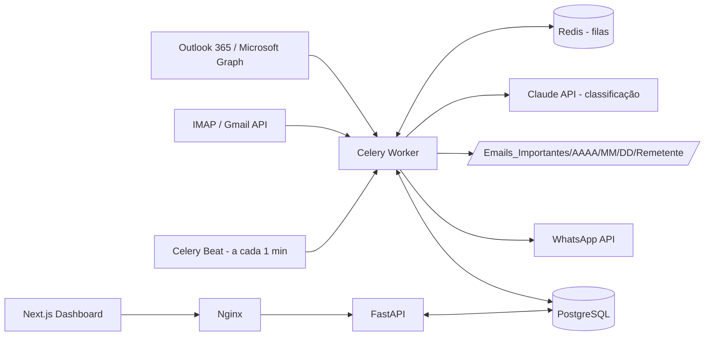
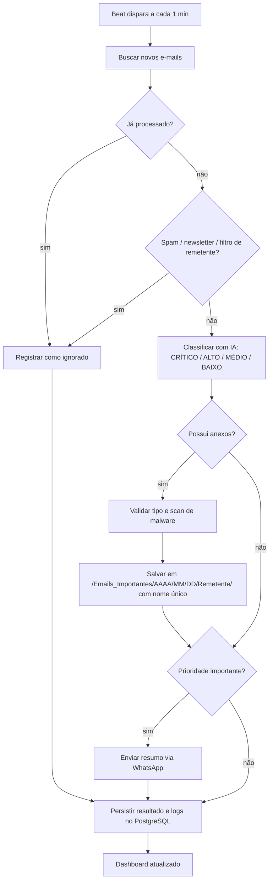

# Arquitetura e Fluxo Operacional

## Visão geral

## Fluxograma operacional

## Segurança
- Credenciais criptografadas (Fernet) em repouso; tokens via variáveis de ambiente.
- Anexos validados por extensão/tipo permitido e isolados do restante do sistema.
- Logs auditáveis no banco; dados pessoais minimizados (LGPD).
