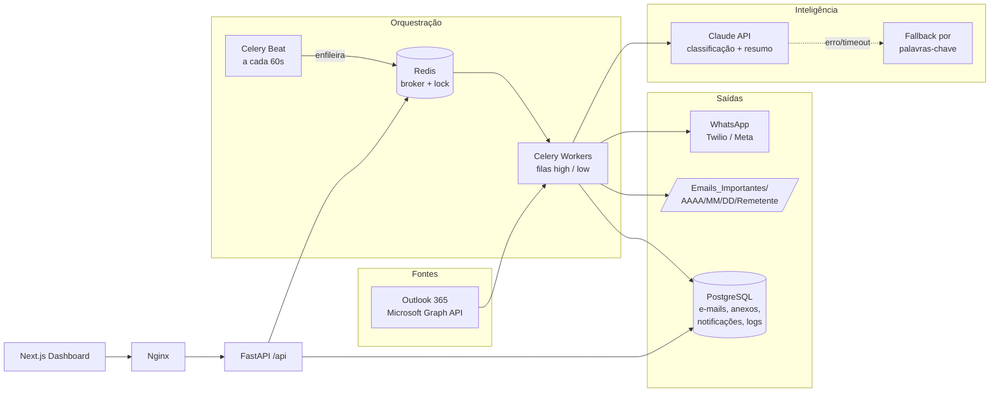
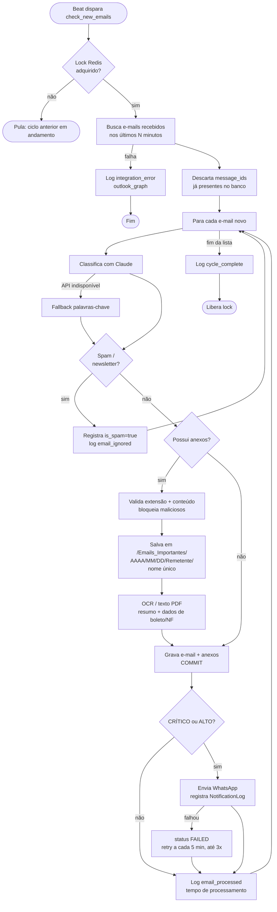
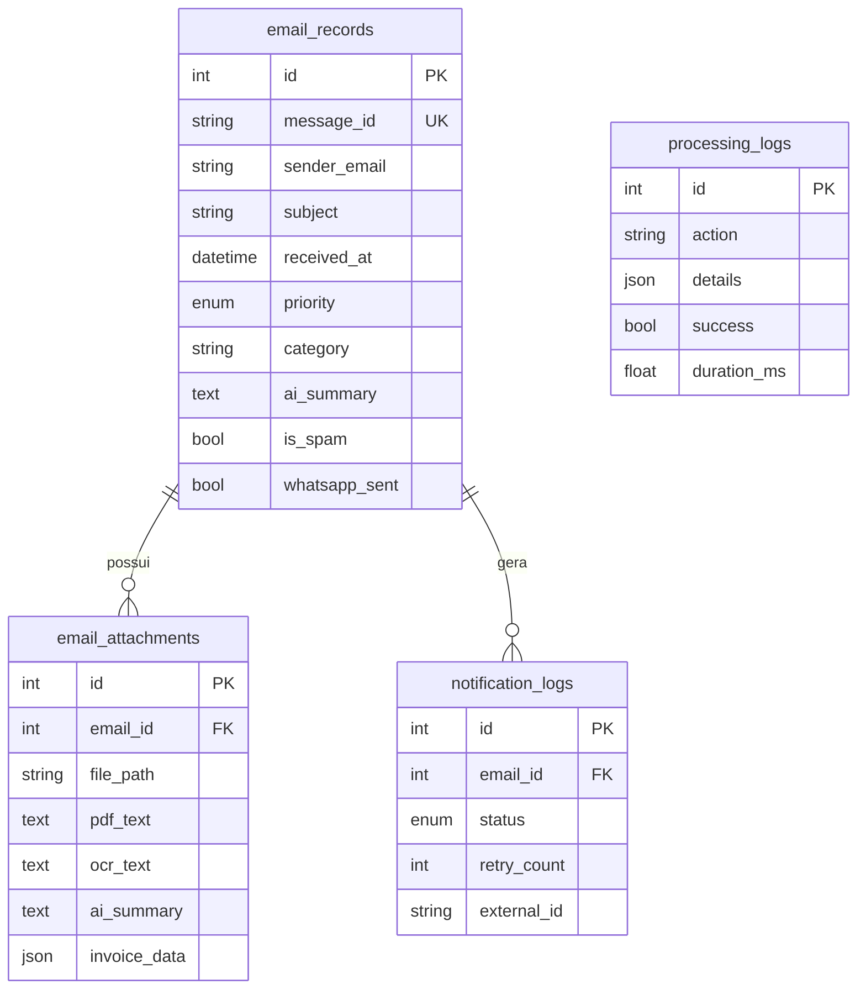

# Arquitetura e Fluxo Operacional

## Visão geral

| Camada | Componente | Responsabilidade |
|---|---|---|
| Ingestão | `services/email_reader.py` | Autenticação MSAL (client credentials), busca por janela de `receivedDateTime`, download de anexos |
| IA | `services/ai_classifier.py` | Prioridade (CRÍTICO/ALTO/MÉDIO/BAIXO), categoria, resumo, spam, ação requerida; resumo de PDF e extração de boleto/NF |
| Anexos | `services/attachment_handler.py` | Whitelist de extensões, bloqueio de executáveis/macros, verificação de assinatura binária, inspeção de ZIP, OCR, texto de PDF |
| Notificação | `services/whatsapp_sender.py` | Formato padronizado, horário local, Twilio ou Meta Cloud API |
| Orquestração | `workers/tasks.py` | Ciclo com lock distribuído, isolamento por e-mail, retentativas, resumo diário, limpeza de logs |
| Auditoria | `services/log_service.py` | Log JSON estruturado (stdout) + tabela `processing_logs` |
| API | `api/routes/*` | Dashboard, e-mails, notificações, configurações, health |

## Fluxograma operacional (um ciclo)

## Garantias de robustez

- **Sem e-mails perdidos:** a busca usa uma janela de tempo (`EMAIL_LOOKBACK_MINUTES`), não o status "não lido". Abrir o e-mail no Outlook antes do ciclo não faz o sistema perdê-lo, e o sistema não altera o status de leitura do usuário (`MARK_AS_READ=false` por padrão).
- **Sem notificações duplicadas:** `message_id` é único no banco, o e-mail é gravado (commit) **antes** do envio do WhatsApp e um lock Redis impede ciclos concorrentes.
- **Falha isolada:** cada e-mail é processado e commitado individualmente; um e-mail malformado gera um `email_processing_error` auditado e não descarta os demais.
- **Event loop seguro:** cada tarefa Celery usa engine próprio com `NullPool` (conexões asyncpg não podem ser compartilhadas entre event loops).
- **IA com degradação controlada:** qualquer erro da Claude API cai no classificador por palavras-chave (busca por palavra inteira), marcado com `classified_by=fallback_keywords`.

## Segurança de anexos

| Verificação | Exemplo bloqueado |
|---|---|
| Extensão perigosa | `.exe`, `.ps1`, `.js`, `.hta`, `.lnk`, `.iso` |
| Arquivos com macro | `.xlsm`, `.docm`, `.pptm` |
| Fora da whitelist | qualquer extensão não listada em `ALLOWED_EXTENSIONS` |
| Executável disfarçado | `fatura.pdf` cujo conteúdo começa com `MZ` |
| Conteúdo × extensão | `.pdf` sem cabeçalho `%PDF` |
| ZIP | contendo executável, corrompido ou protegido por senha |

Imagens inline (logos de assinatura) e itens anexados (convites, e-mails encaminhados como item) não são salvos.

Cada bloqueio gera um registro `attachment_blocked` em `processing_logs`.

## Modelo de dados

