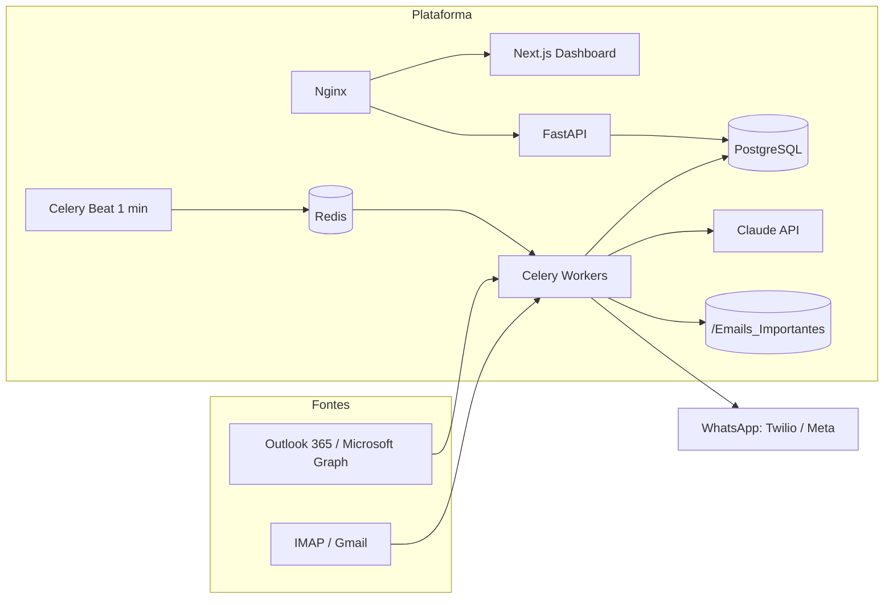
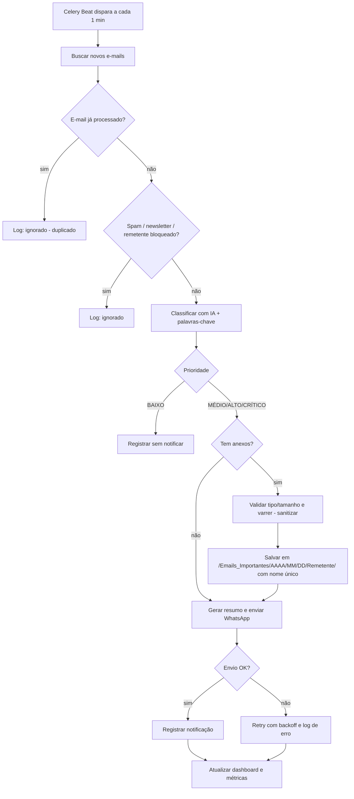

# Arquitetura Corporativa e Fluxograma Operacional

## Visão geral

## Fluxograma operacional

## Decisões e camadas

| Camada | Tecnologia | Responsabilidade |
|---|---|---|
| Entrada | Nginx | TLS, roteamento, rate limit |
| API | FastAPI | REST, dashboard, configurações |
| Fila | Redis + Celery | Polling a cada minuto, retries, escala horizontal |
| IA | Claude API (fallback por regras) | Prioridade, resumo, extração |
| Dados | PostgreSQL | E-mails, anexos, notificações, logs auditáveis |
| Armazenamento | Volume `/Emails_Importantes` | Anexos por ano/mês/dia/remetente |

## Segurança e LGPD

- Credenciais criptografadas (Fernet) e segredos só via variáveis de ambiente.
- Validação de extensão/tamanho de anexos e sanitização de nomes (anti path traversal).
- Logs auditáveis; retenção configurável; minimização de dados no WhatsApp (somente resumo).
- Controle de acesso à API por token.
