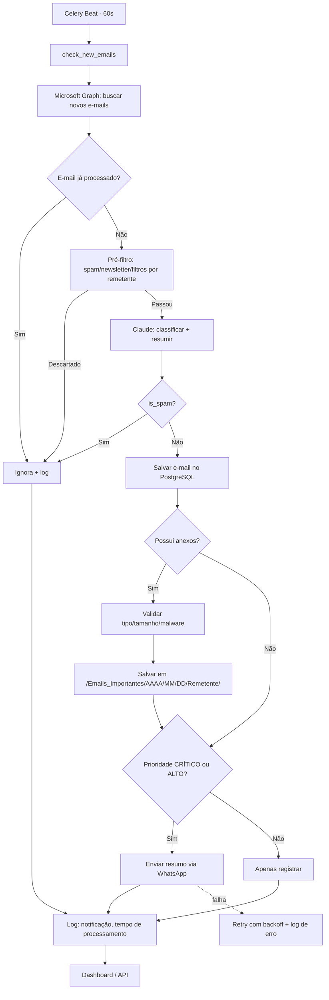

# Arquitetura Corporativa e Fluxograma Operacional

## Componentes

| Camada | Tecnologia | Responsabilidade |
|---|---|---|
| Borda | Nginx | Reverse proxy, TLS, roteamento `/` e `/api` |
| Frontend | Next.js + Tailwind | Dashboard (KPIs, críticos do dia, anexos, falhas, integrações, histórico) |
| API | FastAPI | REST, autenticação, configurações, consulta de logs |
| Fila | Redis + Celery (worker/beat) | Polling a cada 60s, processamento assíncrono |
| IA | Claude API (tool use) | Prioridade, categoria, resumo, detecção de spam |
| Dados | PostgreSQL | E-mails, anexos, notificações, logs auditáveis |
| Integrações | Microsoft Graph (Outlook 365), WhatsApp (Twilio/Meta) | Leitura de e-mails / envio de alertas |
| Armazenamento | `/Emails_Importantes/AAAA/MM/DD/Remetente/` | Anexos com nomes únicos |

## Fluxograma operacional

## Segurança e LGPD

- Credenciais criptografadas em repouso (`utils/crypto.py`); segredos somente via variáveis de ambiente.
- Sanitização de nomes de arquivo e bloqueio de extensões perigosas (`utils/sanitizer.py`, `utils/file_utils.py`).
- Logs estruturados e auditáveis; minimização de dados pessoais nos logs.
- Princípio do menor privilégio no Azure AD (`Mail.Read`).
