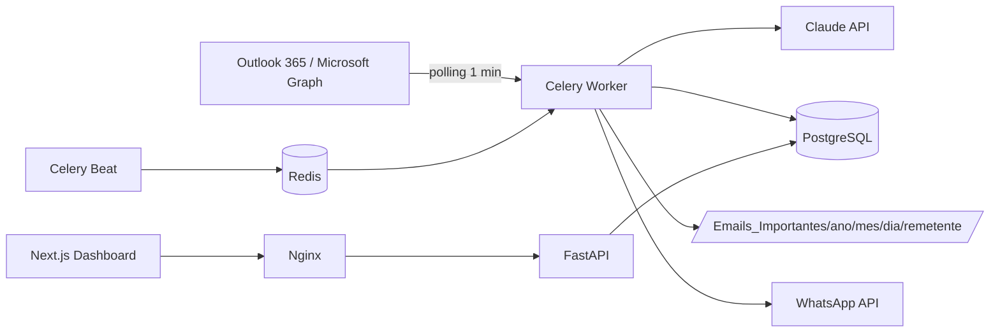
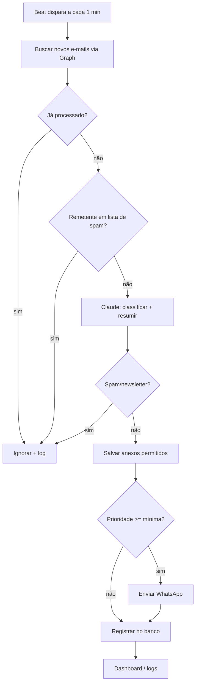

# Arquitetura Corporativa

## Visão de componentes

## Fluxograma operacional

## Segurança
- Credenciais via variáveis de ambiente; criptografia de tokens em repouso (`utils/crypto.py`).
- Anexos: lista de extensões permitidas, nomes sanitizados e deduplicados.
- Logs estruturados e auditáveis; minimização de dados conforme LGPD.
- Nginx como único ponto de entrada; demais serviços em rede interna do Compose.

## Escalabilidade
Workers Celery escaláveis horizontalmente (`docker compose up --scale worker=N`); fila Redis desacopla leitura, IA e envio.
