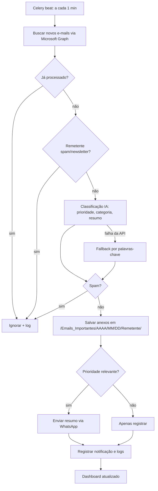

# Arquitetura e Fluxo Operacional

## Componentes

| Camada | Tecnologia | Função |
|---|---|---|
| Entrada | Microsoft Graph (Outlook 365) | Leitura de e-mails e anexos |
| API | FastAPI | REST, dashboard, configurações |
| Fila | Redis + Celery (worker + beat) | Polling a cada 1 min, processamento assíncrono |
| IA | Claude API (fallback por palavras-chave) | Prioridade, resumo, spam |
| Saída | WhatsApp (Twilio / Meta Cloud API) | Notificações |
| Dados | PostgreSQL | E-mails, anexos, notificações, logs |
| Frontend | Next.js + Tailwind | Painel de controle |
| Borda | Nginx | Proxy reverso / TLS |

## Fluxograma operacional

## Segurança
Credenciais criptografadas (Fernet), logs auditáveis, validação de extensão/tamanho de anexos, nomes de arquivo sanitizados e sem sobrescrita, mascaramento de dados pessoais nos logs (LGPD).
