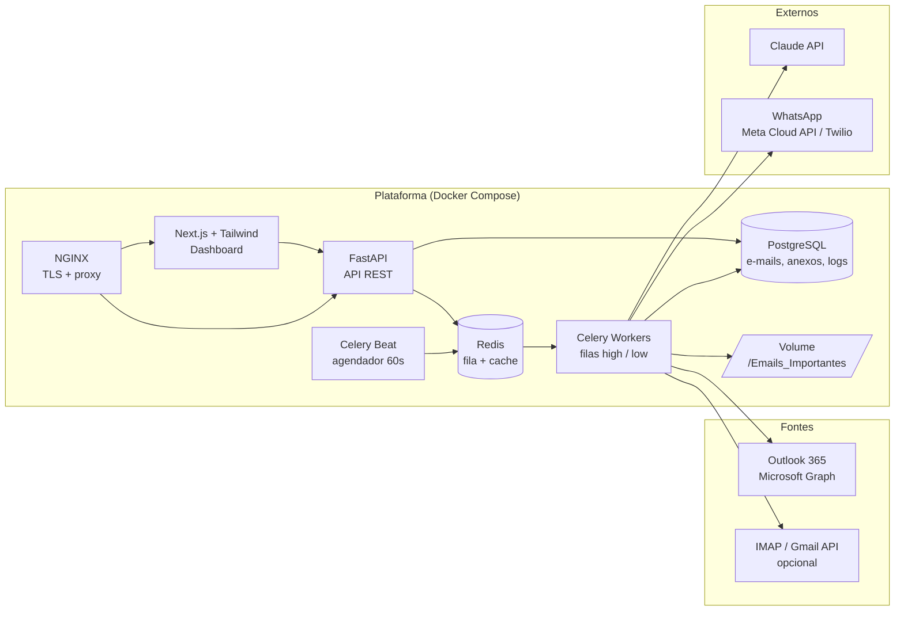

# Arquitetura Corporativa

## Visão em camadas

## Componentes

| Camada | Tecnologia | Responsabilidade |
|---|---|---|
| Ingestão | Microsoft Graph (MSAL client credentials) | Ler assunto, remetente, destinatários, corpo, anexos, data/hora |
| Orquestração | Celery Beat + Redis | Disparo a cada 60s, filas `high` (e-mails) e `low` (relatórios/limpeza) |
| Inteligência | Claude API (fallback por palavras-chave) | Prioridade CRÍTICO/ALTO/MÉDIO/BAIXO, resumo, categoria, spam |
| Notificação | WhatsApp (Meta ou Twilio) | Mensagem estruturada para CRÍTICO/ALTO |
| Arquivos | Volume Docker | `/Emails_Importantes/AAAA/MM/DD/Remetente/` com nomes únicos |
| Persistência | PostgreSQL + SQLAlchemy async + Alembic | Registros, anexos, notificações, logs de processamento |
| Apresentação | Next.js + React Query | KPIs, críticos do dia, falhas, status das integrações, histórico |

## Segurança e LGPD

- Credenciais em variáveis de ambiente; segredos sensíveis criptografados com Fernet (`app/utils/crypto.py`).
- Tokens OAuth2 de curta duração (MSAL), nunca persistidos em disco.
- Bloqueio de extensões executáveis e limite de tamanho por anexo.
- Sanitização de nomes de arquivos/pastas (sem path traversal).
- Logs de processamento auditáveis no PostgreSQL (quem/quando/o quê/duração).
- Minimização: o WhatsApp recebe apenas resumo, nunca o corpo integral nem anexos.
- Retenção configurável e limpeza de pastas vazias pela rotina diária.

## Escalabilidade

- Workers stateless: escale com `docker compose up -d --scale celery-worker=N`.
- Deduplicação por `message_id` do Graph evita reprocessamento entre workers.
- Pool de conexões do banco descartado ao fim de cada tarefa Celery (loop asyncio isolado por tarefa).
