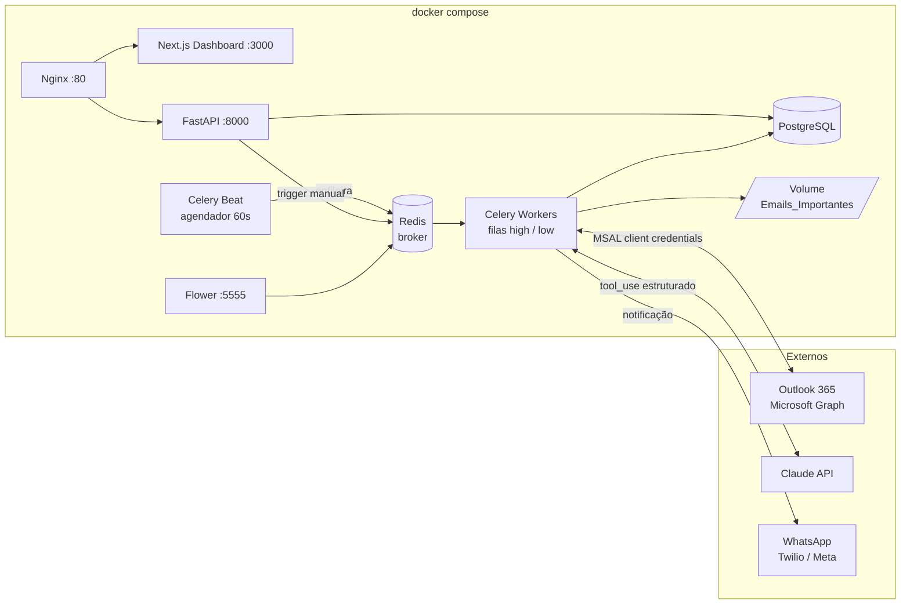
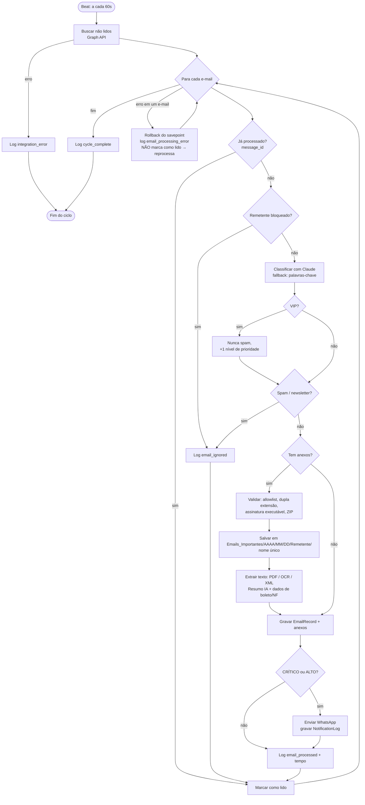
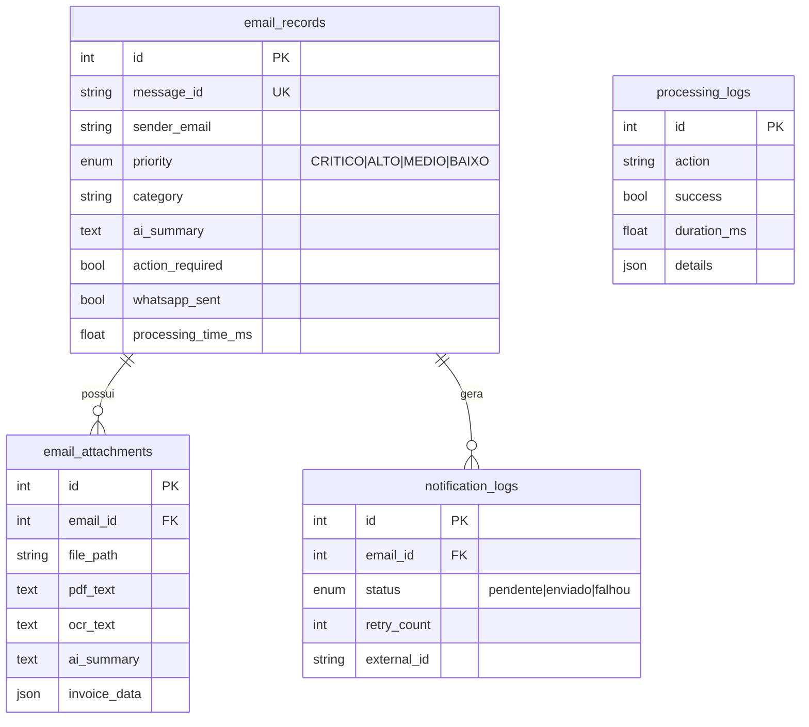

# Arquitetura e Fluxo Operacional

## Visão de componentes

| Camada | Responsabilidade | Escala |
|---|---|---|
| Celery Beat | Dispara `check_new_emails` a cada `CHECK_INTERVAL_SECONDS` | 1 réplica (singleton) |
| Celery Worker | Leitura, IA, anexos, WhatsApp, logs | Horizontal (`--scale celery-worker=N`) |
| FastAPI | API REST do painel, gatilhos manuais | Horizontal atrás do Nginx |
| PostgreSQL | E-mails, anexos, notificações, logs de auditoria | Vertical / réplica de leitura |
| Redis | Broker + backend de resultados | Sentinel/Cluster em produção |

## Fluxograma operacional (um ciclo)

### Garantias do ciclo

- **Idempotência**: `message_id` único; reprocessar não duplica registro nem notificação.
- **Isolamento de falhas**: cada e-mail roda dentro de um *savepoint*; um erro não desfaz o lote.
- **Sem perda**: e-mails só são marcados como lidos depois de gravados; falhas voltam no próximo ciclo.
- **Retentativa de WhatsApp**: `retry_failed_notifications` a cada 5 min (até 3 tentativas).
- **Resumo diário**: `send_daily_summary` às 08:00 (America/Sao_Paulo).
- **Retenção**: `cleanup_old_logs` semanal, conforme `LOG_RETENTION_DAYS` (LGPD).

## Modelo de dados

## Segurança

| Controle | Implementação |
|---|---|
| Credenciais | Somente via variáveis de ambiente / `.env` (fora do git); utilitário Fernet em `app/utils/crypto.py` |
| Graph API | Client Credentials (MSAL), token em memória com renovação 60s antes de expirar |
| Anexos maliciosos | Allowlist de extensões, bloqueio de dupla extensão e macros (`.docm/.xlsm`), detecção de assinatura executável, inspeção de ZIP (executáveis, path traversal, zip bomb) |
| Auditoria | `processing_logs` registra processados, ignorados, anexos, WhatsApp, erros e tempos |
| LGPD | Retenção configurável, sem senhas em texto plano, dados mínimos na notificação |

### Limitações conhecidas / próximos passos

- **Autenticação do painel/API**: a API ainda não exige login. Em produção, exponha apenas
  pela VPN/rede interna ou habilite `auth_basic` no Nginx até a implementação de JWT.
- **Antivírus**: a inspeção de anexos é heurística; para ambiente regulado, integre ClamAV
  (`clamd`) antes de gravar o arquivo.
- **Tempo real**: o polling é de 60s. Para latência menor, use *change notifications*
  (webhooks) do Microsoft Graph apontando para um endpoint da API.
- **Migrações**: tabelas são criadas no startup (`create_all`); adote Alembic antes de
  alterar o schema em produção.
