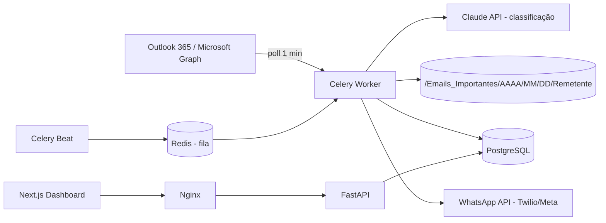
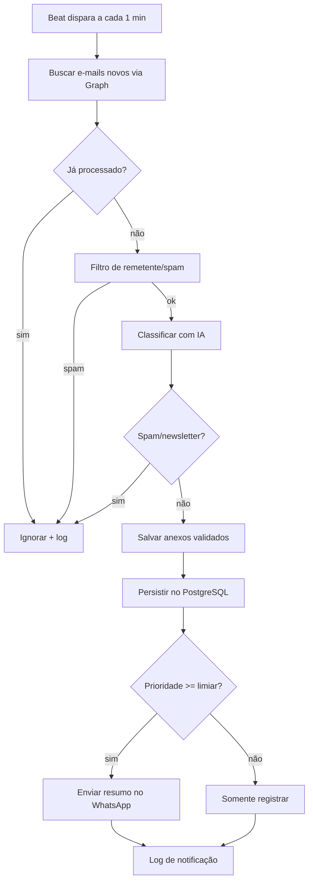

# Arquitetura Corporativa e Fluxo Operacional

## Visão de componentes

## Fluxograma operacional

## Camadas e responsabilidades

| Camada | Tecnologia | Função |
|---|---|---|
| Ingestão | Microsoft Graph, Celery Beat | Polling a cada minuto |
| Processamento | Celery + Redis | Filas, retentativas, escala horizontal |
| IA | Claude API (tool use) | Prioridade, categoria, resumo, spam |
| Persistência | PostgreSQL, Alembic | E-mails, anexos, notificações, logs |
| Notificação | WhatsApp (Twilio/Meta) | Resumo estruturado |
| Apresentação | Next.js + Tailwind | Dashboard |
| Borda | Nginx | TLS, proxy reverso |

## Segurança
Credenciais em variáveis de ambiente/segredos, criptografia de tokens (`utils/crypto.py`), validação de tipo/tamanho de anexos, nomes sanitizados e sem duplicidade, logs auditáveis e retenção conforme LGPD.
