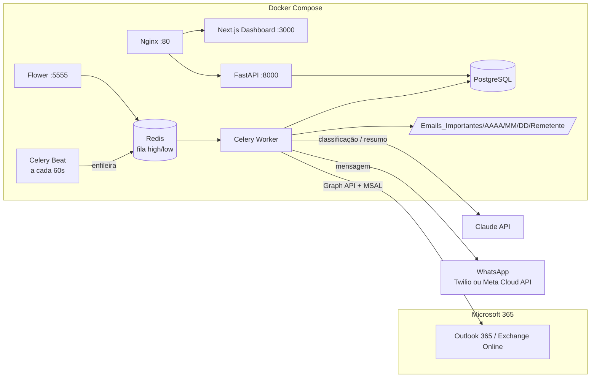
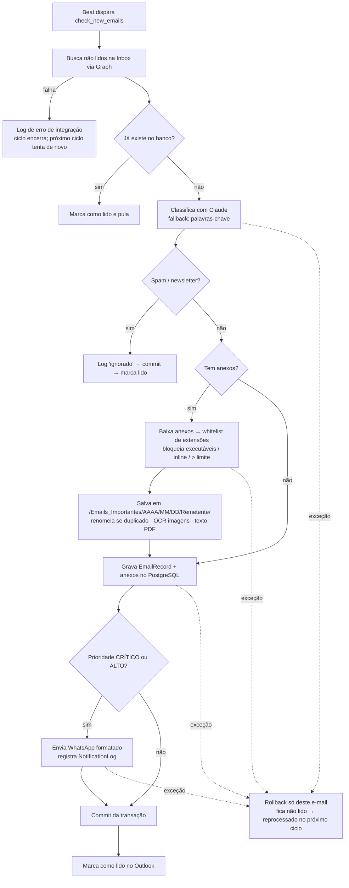

# Arquitetura e Fluxograma Operacional

## Visão corporativa

## Fluxograma de processamento (a cada ciclo)

## Rotinas agendadas

| Rotina | Frequência | Fila |
|---|---|---|
| `check_new_emails` | `CHECK_INTERVAL_SECONDS` (padrão 60s) | high |
| `retry_failed_notifications` | 5 min (até 3 tentativas) | high |
| `send_daily_summary` | 08:00 America/Sao_Paulo | low |
| `cleanup_old_logs` | domingo 02:00 (`LOG_RETENTION_DAYS`) | low |

## Garantias de consistência

- **Nenhum e-mail se perde:** ele só é marcado como lido depois que o registro foi gravado no banco.
- **Isolamento de falhas:** cada e-mail é uma transação; se um falhar, ele é desfeito e o resto do lote segue.
- **Idempotência:** `message_id` único evita processar duas vezes e notificar em duplicidade.

## Segurança

- API REST protegida por `X-API-Key` (`API_KEY`); sem chave configurada, o acesso fica livre e um aviso aparece no log (use isso só em desenvolvimento).
- `NEXT_PUBLIC_API_KEY` fica embutida no bundle do dashboard. Exponha o dashboard só na rede interna/VPN, ou coloque SSO (ex.: Azure AD via oauth2-proxy) na frente do Nginx.
- Credenciais criptografadas com Fernet (`ENCRYPTION_KEY`), sem segredos versionados (`.env` fica no `.gitignore`).
- Anexos: whitelist (PDF, XLSX/XLS, DOCX/DOC, CSV, ZIP, imagens, XML, TXT) e bloqueio de executáveis.
- LGPD: retenção configurável de logs; os dados ficam só na infraestrutura própria e no provedor de IA contratado.
