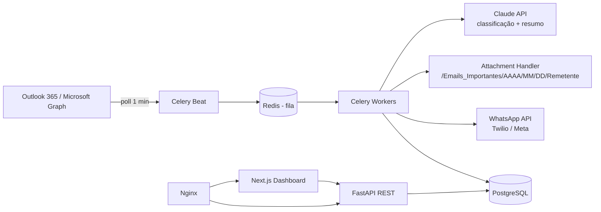
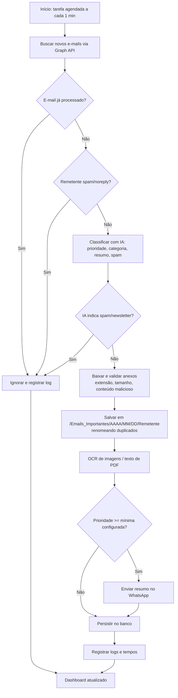

# Arquitetura e Fluxo Operacional

## Visão geral



## Fluxograma operacional



## Camadas

| Camada | Tecnologia | Responsabilidade |
|---|---|---|
| Ingestão | Microsoft Graph (OAuth2 client credentials) | Ler e-mails e anexos |
| Orquestração | Celery + Redis | Agendamento, filas, retentativas |
| IA | Claude API (tool_use) | Prioridade, resumo, spam |
| Persistência | PostgreSQL + Alembic | E-mails, anexos, notificações, logs |
| Entrega | Twilio / Meta WhatsApp | Notificação estruturada |
| API | FastAPI | Dashboard, notificações, configurações |
| UI | Next.js + Tailwind | Painel de controle |

## Segurança e LGPD

- Credenciais apenas via variáveis de ambiente; tokens/segredos criptografados (`utils/crypto.py`).
- Anexos validados por extensão permitida, tamanho e inspeção básica antes de gravar.
- Logs de processamento e notificações auditáveis em tabelas próprias.
- Recomenda-se política de retenção e base legal documentada para o conteúdo de e-mails (LGPD).

## Migrações

```bash
cd backend && alembic upgrade head
```
