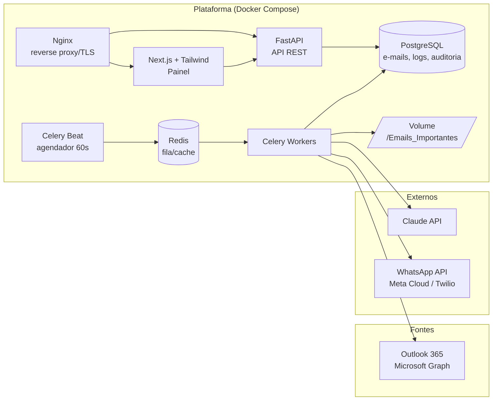
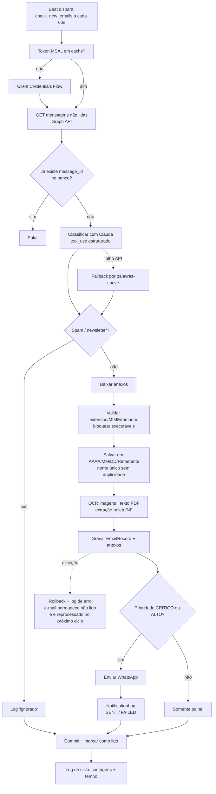

# Arquitetura Corporativa e Fluxograma Operacional

## Visão de componentes

## Fluxograma operacional (um ciclo)

## Garantias de processamento

| Garantia | Como |
|---|---|
| Sem perda de e-mail | Marca como lido **somente após** commit no PostgreSQL |
| Sem duplicidade | `message_id` único + verificação antes do processamento |
| Isolamento de falhas | Commit/rollback por e-mail; erro em um não afeta os demais |
| Reenvio de notificações | `retry_failed_notifications` (até 3 tentativas) |
| Retenção LGPD | `cleanup_old_logs` remove logs além de `LOG_RETENTION_DAYS` |

## Rotinas agendadas (Celery Beat)

| Tarefa | Frequência | Função |
|---|---|---|
| `check_new_emails` | 60 s | ciclo principal |
| `retry_failed_notifications` | periódica | reenvia WhatsApp com falha |
| `send_daily_summary` | diária | resumo do dia via WhatsApp |
| `cleanup_old_logs` | diária | retenção de logs |

## Segurança

- Credenciais criptografadas em repouso (`app/utils/crypto.py`, Fernet).
- Sanitização de corpo/HTML e nomes de arquivo (`app/utils/sanitizer.py`).
- Bloqueio de anexos executáveis e limite de tamanho.
- Logs de auditoria persistidos em `processing_logs`.
- Princípio do menor privilégio no Azure AD: permissão `Mail.ReadWrite` restrita via *Application Access Policy* à caixa monitorada.
