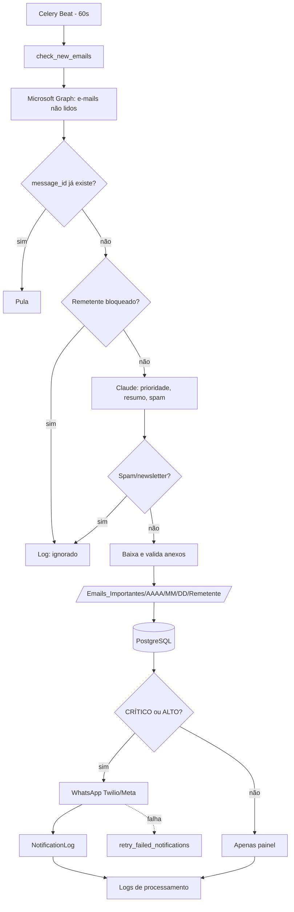

# Arquitetura e Fluxo Operacional

## Componentes

| Camada | Tecnologia | Responsabilidade |
|---|---|---|
| Proxy | Nginx | Entrada única (`/` → frontend, `/api/` → backend) |
| API | FastAPI | Dashboard, e-mails, notificações, configurações (protegida por `X-API-Key`) |
| Agendador | Celery Beat | Dispara `check_new_emails` a cada 60s, resumo diário, retry, limpeza de logs |
| Workers | Celery + Redis | Leitura Graph API, classificação Claude, anexos, WhatsApp |
| Banco | PostgreSQL | E-mails, anexos, notificações e logs de processamento |
| Frontend | Next.js + Tailwind | Painel de controle |

## Fluxograma operacional

## Segurança

- `API_KEY`: define-a no `.env`; todas as rotas `/api/*` (exceto `/api/health`) exigem `X-API-Key`. Vazia = desativado (somente desenvolvimento).
- `NEXT_PUBLIC_API_KEY` é exposta no bundle do navegador; em produção prefira injetar o header no Nginx e proteger o acesso ao painel (VPN/SSO/basic auth).
- Credenciais criptografadas (Fernet), bloqueio de extensões executáveis, logs auditáveis com retenção configurável.
- `BLOCKED_SENDER_PATTERNS`: filtro personalizado por remetente.

## Limitações conhecidas

- Gmail/IMAP: apenas Outlook 365 (Graph) está implementado.
- Sem migrações Alembic (tabelas via `create_all`).
- Aprendizado contínuo e resposta automática não implementados.
