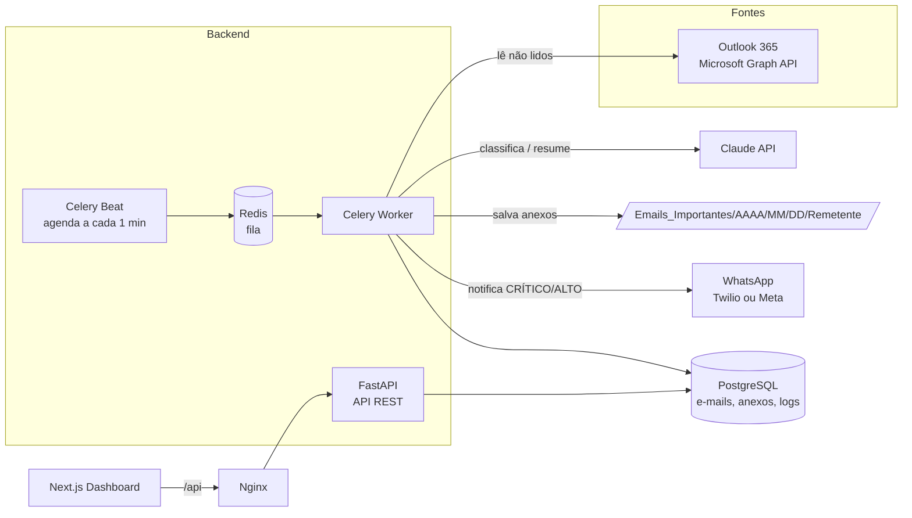
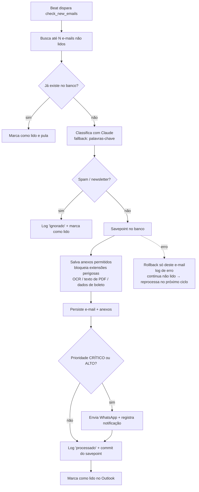

# Arquitetura e Fluxo Operacional

## Componentes

## Fluxo de um ciclo

## Garantias de processamento

| Situação | Comportamento |
|---|---|
| Falha ao processar um e-mail | Rollback apenas daquele e-mail (savepoint); demais do lote são gravados |
| Falha antes de persistir | E-mail permanece **não lido** e é reprocessado no próximo ciclo |
| Persistiu mas falhou ao marcar como lido | No próximo ciclo é detectado como duplicado e apenas marcado como lido (sem nova notificação) |
| Claude API indisponível | Classificação por palavras-chave configuráveis |
| WhatsApp falhou | Notificação gravada como `FAILED`; tarefa `retry_failed_notifications` tenta até 3 vezes |

## Rotinas agendadas (Celery Beat)

| Tarefa | Função |
|---|---|
| `check_new_emails` | Ciclo principal (intervalo `CHECK_INTERVAL_SECONDS`) |
| `retry_failed_notifications` | Reenvia notificações WhatsApp falhas (a cada 5 min) |
| `send_daily_summary` | Resumo diário via WhatsApp (08:00) |
| `cleanup_old_logs` | Remove logs mais antigos que `LOG_RETENTION_DAYS` (domingo 02:00) |

## Fuso horário

Horários das mensagens e as pastas `AAAA/MM/DD` usam `TIMEZONE` (padrão `America/Sao_Paulo`),
evitando que um e-mail recebido às 22h seja arquivado na pasta do dia seguinte (UTC).
