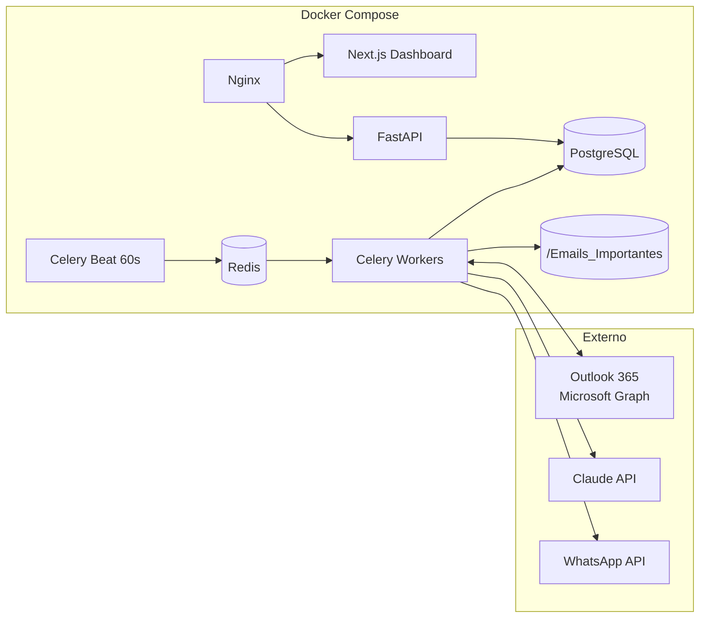
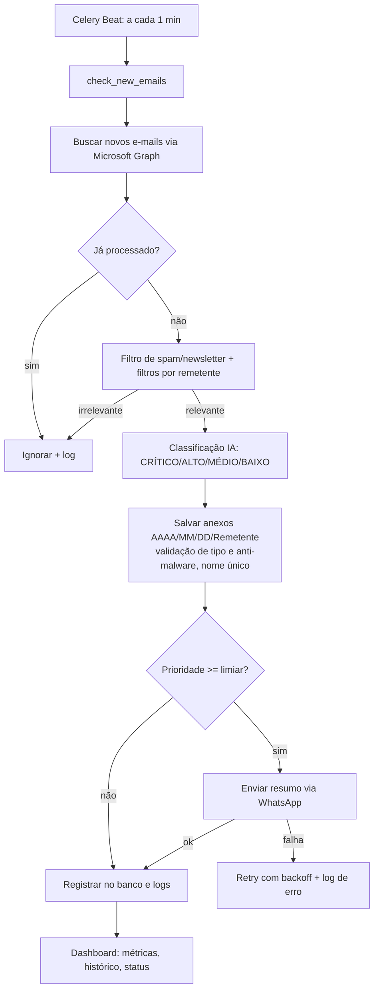

# Arquitetura Corporativa e Fluxograma Operacional

## 1. Visão geral dos componentes

## 2. Fluxograma operacional

## 3. Camadas e responsabilidades

| Camada | Tecnologia | Responsabilidade |
|---|---|---|
| Borda | Nginx | TLS, roteamento, rate limit |
| Apresentação | Next.js + Tailwind | Dashboard, histórico, status |
| API | FastAPI | REST, autenticação, configurações |
| Processamento | Celery + Redis | Polling, IA, anexos, notificações |
| Persistência | PostgreSQL | E-mails, anexos, notificações, logs |
| Arquivos | Volume `/Emails_Importantes` | Anexos por ano/mês/dia/remetente |

## 4. Segurança e LGPD

- Credenciais criptografadas em repouso (`utils/crypto.py`); segredos apenas via variáveis de ambiente.
- Sanitização de nomes/conteúdo (`utils/sanitizer.py`) e allowlist de extensões (PDF, XLSX, DOCX, CSV, ZIP, imagens, XML).
- Logs auditáveis sem corpo completo do e-mail; minimização de dados e retenção configurável.
- Princípio do menor privilégio nas permissões do app no Azure (somente `Mail.Read`).

## 5. Escalabilidade

- Workers Celery horizontais (`docker compose up --scale worker=N`).
- Idempotência por `message_id` evita duplicidade em reprocessamentos.
- Filas separadas por tipo de tarefa permitem priorizar notificações críticas.
