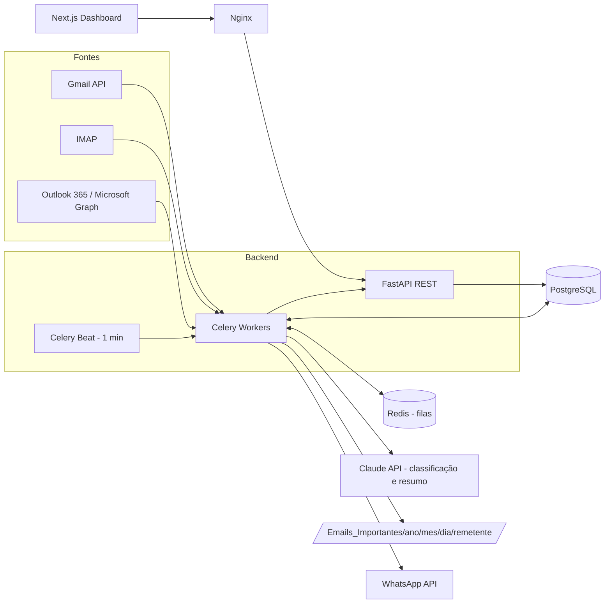
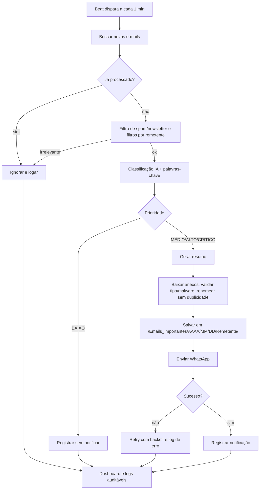

# Arquitetura corporativa e fluxograma operacional

## Componentes

## Fluxo operacional

## Segurança

- Credenciais criptografadas em repouso (`utils/crypto.py`, Fernet); segredos apenas via variáveis de ambiente.
- Sanitização de nomes e caminhos de anexos; whitelist de extensões (PDF, XLSX, DOCX, CSV, ZIP, imagens, XML).
- Logs auditáveis em banco; dados pessoais minimizados nos logs (LGPD).
- Nginx como único ponto de entrada; PostgreSQL e Redis fora da rede pública.
