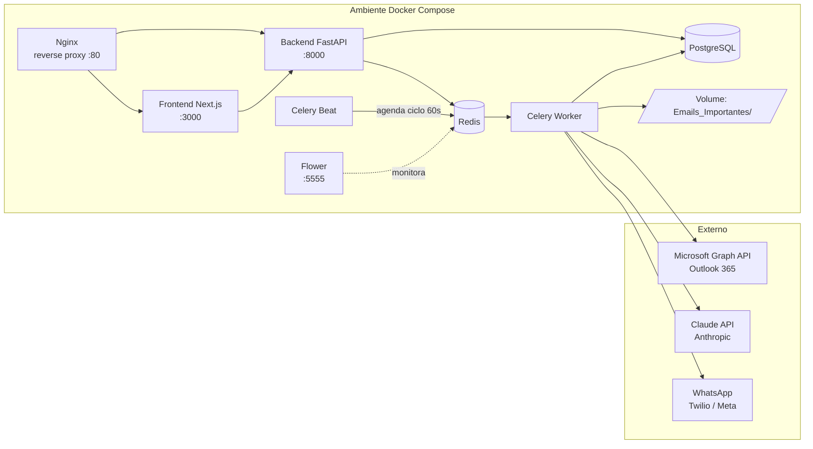

# Arquitetura Corporativa

Documento de referência da arquitetura do Sistema de Monitoramento de E-mails,
para uso por times de infraestrutura, segurança e engenharia.

## 1. Visão geral



## 2. Componentes

| Componente | Responsabilidade | Tecnologia |
|---|---|---|
| Nginx | Roteamento único de entrada, TLS termination (produção) | nginx |
| Frontend | Dashboard operacional | Next.js + TailwindCSS |
| Backend | API REST, health checks, disparo manual de ciclos | FastAPI |
| Celery Beat | Agenda periódica (verificação de e-mails, resumo diário, limpeza de logs) | Celery |
| Celery Worker | Execução assíncrona: leitura, classificação, anexos, notificação | Celery |
| PostgreSQL | Persistência de e-mails, anexos, notificações e logs | PostgreSQL 16 |
| Redis | Broker de fila + backend de resultados do Celery | Redis 7 |
| Flower | Observabilidade das filas Celery | Flower |

## 3. Fluxo de dados

1. **Celery Beat** dispara `check_new_emails` a cada `CHECK_INTERVAL_SECONDS` (padrão 60s).
2. **OutlookEmailReader** autentica via MSAL (client credentials) e busca mensagens não lidas via Microsoft Graph (`/users/{email}/mailFolders/inbox/messages`).
3. **AIClassifier** (Claude) classifica prioridade (CRÍTICO/ALTO/MÉDIO/BAIXO), categoria, resumo e sinaliza spam.
4. E-mails classificados como spam são registrados e descartados do restante do fluxo.
5. **AttachmentHandler** salva anexos em `Emails_Importantes/AAAA/MM/DD/Remetente/`, com sanitização de nomes, bloqueio de extensões perigosas, OCR (imagens) e extração de texto (PDF).
6. Para documentos financeiros (boleto/fatura/nota fiscal), a IA extrai dados estruturados (valor, vencimento, emitente, CNPJ/CPF).
7. E-mails CRÍTICO/ALTO disparam notificação via **WhatsAppSender** (Twilio ou Meta Business API).
8. Todo o ciclo é registrado em `processing_logs` e `notification_logs` (PostgreSQL) e via `structlog` (stdout/JSON).
9. O **Frontend** consome `/api/dashboard/*` para exibir estatísticas, e-mails recentes e histórico de notificações.

## 4. Segurança

- **Credenciais**: nunca versionadas; injetadas via `.env` / secrets do orquestrador (Docker secrets, Vault, etc. em produção).
- **Controle de acesso**: API protegida por header `X-API-Key` (`API_ACCESS_KEY`), validado em `app/api/deps.py`. Recomenda-se colocar o dashboard atrás de VPN/SSO corporativo além da chave.
- **Criptografia**: utilitário `app/utils/crypto.py` (Fernet) disponível para criptografar credenciais/segredos persistidos.
- **Anexos maliciosos**: bloqueio por extensão (`app/services/attachment_handler.py::DANGEROUS_EXTENSIONS`) e limite de tamanho (`MAX_ATTACHMENT_SIZE_MB`).
- **LGPD**: dados pessoais (remetente, corpo do e-mail) ficam restritos ao ambiente interno; `LOG_RETENTION_DAYS` define expurgo automático de `processing_logs` via tarefa `cleanup_old_logs`.
- **Auditoria**: todas as ações (processado, ignorado, anexo salvo, notificação enviada/falhou, erro) são logadas com timestamp e contexto.

## 5. Escalabilidade

- Celery Worker é stateless e pode ser escalado horizontalmente (`docker compose up --scale celery-worker=N`).
- Filas separadas (`high`, `low`) permitem priorizar processamento crítico.
- PostgreSQL e Redis podem ser substituídos por serviços gerenciados (RDS/ElastiCache, Azure Database/Cache) sem alteração de código, apenas `DATABASE_URL`/`REDIS_URL`.

## 6. Migrações de schema

Controladas via Alembic (`backend/alembic/`). Fluxo recomendado em produção:

```bash
docker compose exec backend alembic upgrade head
```

O `create_all` em `app/db/database.py` permanece apenas como bootstrap de conveniência para ambientes de desenvolvimento sem migrations aplicadas.
