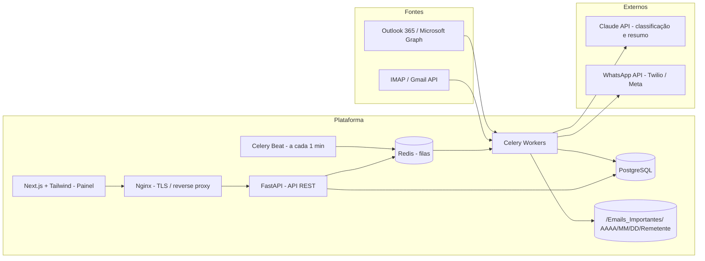
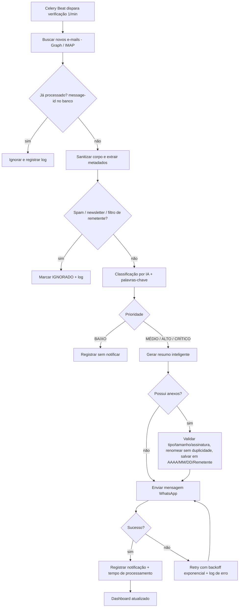

# Arquitetura Corporativa e Fluxograma Operacional

## Visão geral

## Fluxograma operacional

## Camadas e responsabilidades

| Camada | Tecnologia | Responsabilidade |
|---|---|---|
| Apresentação | Next.js, TailwindCSS | Dashboard: métricas, críticos do dia, anexos, falhas, integrações, histórico |
| Borda | Nginx | TLS, rate limiting, roteamento `/api` e `/` |
| API | FastAPI | REST, autenticação, configurações, consulta de e-mails/notificações |
| Processamento | Celery + Redis | Polling a cada 1 min, pipeline assíncrono, retries, escala horizontal de workers |
| IA | Claude API (OpenAI opcional) | Prioridade, resumo, tipo (aprovação, cobrança, contrato...) |
| Persistência | PostgreSQL | E-mails, anexos, notificações, logs auditáveis |
| Armazenamento | Volume `/Emails_Importantes/` | Anexos organizados por Ano/Mês/Dia/Remetente |

## Escalabilidade e resiliência

- Workers Celery stateless: `docker compose up --scale worker=N`.
- Idempotência por `message-id`; reprocessamento seguro.
- Retries com backoff exponencial em Graph, Claude e WhatsApp; falhas registradas em log e no painel.
- Healthchecks nos containers; filas desacopladas por Redis.

## Segurança e LGPD

- Credenciais e tokens criptografados em repouso (Fernet); segredos apenas via variáveis de ambiente.
- Anexos: lista de extensões permitidas (PDF, XLSX, DOCX, CSV, ZIP, imagens, XML), limite de tamanho, checagem de assinatura/magic bytes, nomes sanitizados contra path traversal.
- Logs auditáveis com mascaramento de dados pessoais; retenção configurável.
- Princípio do menor privilégio no Azure AD (`Mail.Read`); acesso ao painel autenticado.

## Roadmap (funcionalidades avançadas)

Aprendizado contínuo de prioridades (feedback do usuário), resposta automática opcional, resumo de PDF, OCR de imagens, extração de dados de boletos/NF-e, agrupamento por assunto, filtros por remetente.
