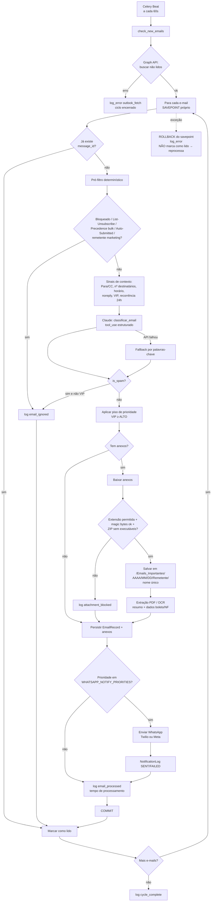

# Fluxograma Operacional

## Ciclo de monitoramento (a cada `CHECK_INTERVAL_SECONDS`, padrão 60s)

## Rotinas agendadas

| Rotina | Agenda | Fila | O que faz |
|---|---|---|---|
| `check_new_emails` | a cada 60s | `high` | Ciclo acima |
| `retry_failed_notifications` | a cada 5 min | `high` | Reenvia WhatsApp com status `FAILED` (máx. 3 tentativas, mesmo dia) |
| `send_daily_summary` | 08:00 (America/Sao_Paulo) | `low` | Resumo do dia via WhatsApp |
| `cleanup_old_logs` | domingo 02:00 | `low` | Remove `processing_logs` com mais de `LOG_RETENTION_DAYS` |

## Garantias

- **Nenhum e-mail se perde**: só é marcado como lido depois do `COMMIT`. Se o processamento falhar, ele continua não lido e entra no próximo ciclo.
- **Idempotência**: `message_id` é único. Reprocessar o mesmo e-mail não gera registro, anexo ou WhatsApp duplicado.
- **Isolamento**: uma falha em um e-mail desfaz apenas o savepoint dele, e o restante do lote segue.
