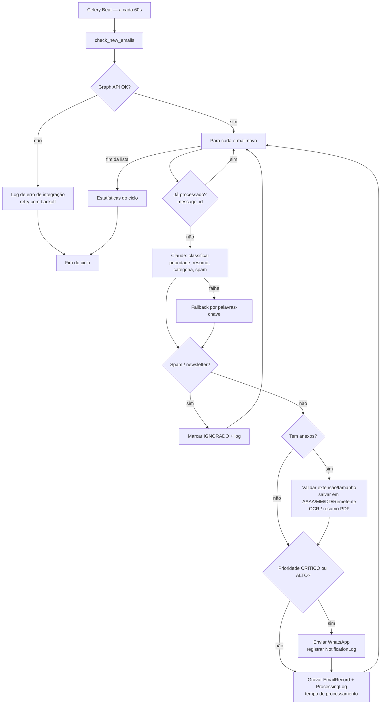

# Fluxograma Operacional

## Rotinas agendadas

| Rotina | Frequência | Função |
|---|---|---|
| `check_new_emails` | 60s | Ciclo principal acima |
| `send_daily_summary` | diária, 08:00 | Resumo do dia via WhatsApp |
| `retry_failed_notifications` | 5 min | Reenvio de notificações WhatsApp que falharam |
| `cleanup_old_logs` | semanal, domingo 02:00 | Retenção de logs e limpeza de pastas vazias |
