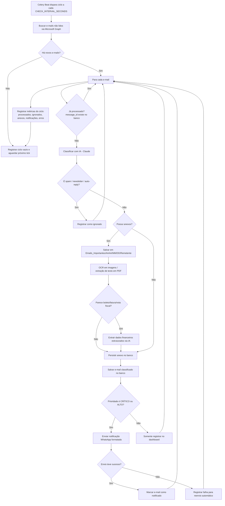

# Fluxograma Operacional

Fluxo de decisão executado a cada ciclo de processamento (`check_new_emails`,
`app/workers/tasks.py`).

## Tarefas periódicas complementares

Agendadas em `app/workers/celery_app.py::beat_schedule`:

| Tarefa | Frequência configurada | Função |
|---|---|---|
| `check_new_emails` | A cada `CHECK_INTERVAL_SECONDS` (padrão 60s) | Fluxo principal acima |
| `retry_failed_notifications` | A cada 5 min | Reenvia notificações WhatsApp que falharam (até 3 tentativas/dia) |
| `send_daily_summary` | Diariamente às 08:00 (America/Sao_Paulo) | Envia resumo consolidado via WhatsApp |
| `cleanup_old_logs` | Domingos às 02:00 (America/Sao_Paulo) | Remove `processing_logs` mais antigos que `LOG_RETENTION_DAYS` |
